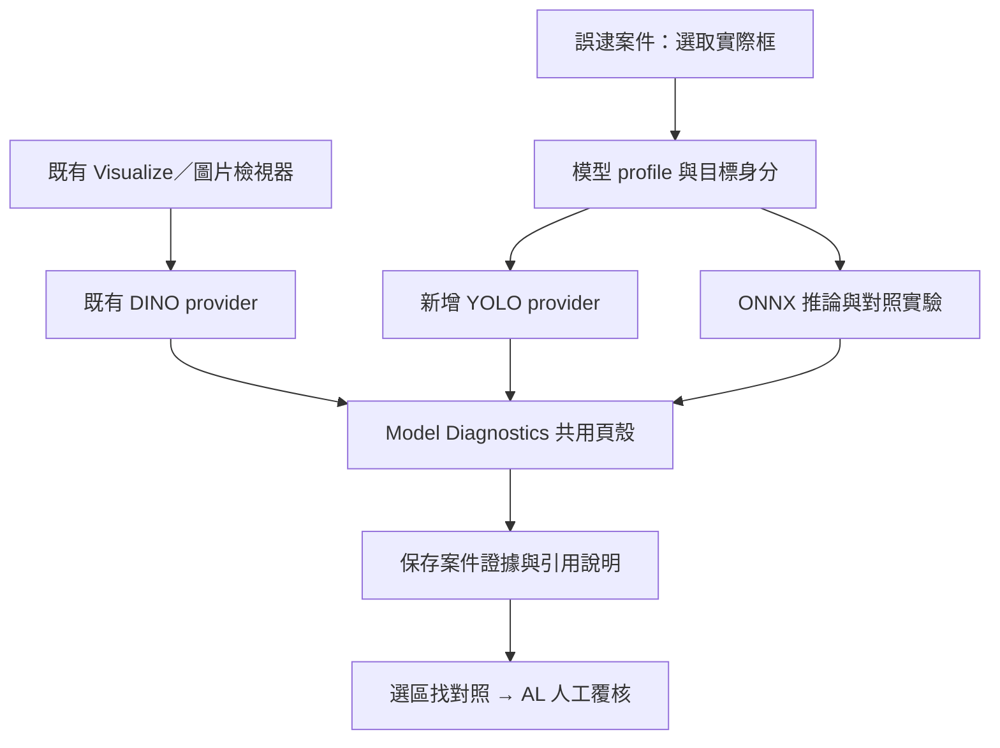

## Context

日期：2026-09-06。狀態：規劃完成，以下新增能力尚未實作。

整體操作重新檢視見 [LV 誤逮調查產品檢視](../../../docs/lv-investigation-product-review.md)。該文件的 U01–U16 是本 change 必要使用情境；下列技術設計須共同滿足，不得只完成模型／CAM 接入就宣稱端到端交付。

操作補充優先於原本偏模型設定的順序：支援「先報案」與「先匯入模型」兩入口；來源影像可先推論，不必先建立人工 ROI。標準流程不要求伺服器路徑、內部 ID 或 JSON。加入多檔匯入／class mapping、圖上修正／撤回、部分歷史紀錄／有效零框、現場判定階段、可攜圖文回覆、資料集與訓練／評估表單、持久工作／衝突恢復與基本案件／模型維護。

使用者要調查外部模型的誤逮，有大量 YOLO 應用，並明確要求將 Grad-CAM 設計進產品。本設計經三個 agent 三輪檢視，主 agent 裁決後收斂；不是將既有熱圖重新命名為外部模型解釋。

### 已查到的既有實作與整合關係

| 既有檔案／函式 | 現在負責什麼 | 本設計的關係 |
|---|---|---|
| `scripts/gradcam_explain.py::token_gradcam_map` | DINO token hooks、FrozenLogisticHead、target/reference margin、signed CAM 與單圖遮擋 audit | 保留演算法，包為 DINO provider；YOLO 使用獨立計算 adapter |
| `scripts/explain_ui.py::render_explainability_panel` | 圖片 inspector 的 Attention／Grad-CAM 等面板 | 保留既有入口與 DINO 操作 |
| `scripts/app.py::_model_diagnostics_ui` | 獨立診斷入口，持有 head 準備、執行與 session orchestration | 先依來源/provider 分流；DINO 路徑保留，YOLO 不進 head 訓練 |
| `scripts/explain_page.py::render_model_diagnostics_page` | render-only 頁面，但目前文案／view model 綁定分類 head、OOF、margin | 共用頁殼與影像呈現，新增 detector 專用 view model／文字 |
| `scripts/explanation_render.py` | 原圖 overlay、正負色盤、grid、PNG／JSON | 重用繪圖元件；增加完整 detector geometry 和方法語意，不使用 DINO 固定 patch 規則 |
| `scripts/explain_contracts.py`／`explain_context.py` | V1 context/run/render、hash、stale／late-result | 保留 V1 既有序列化與 hash；新增 detector V2 與明確分派 |
| `scripts/fp_external_runtime.py` | ONNX 推論、解碼、NMS、`output_index`、tensor／幾何保存 | 重用部署輸出與身分，新增與梯度 backend 的對應驗證 |
| `scripts/fp_investigation.py::target_observation` | 每次擾動依 class＋ROI 重新匹配框 | 保留實務警報變化；新增固定 scalar trace 才能作 CAM 忠實度檢查 |
| `scripts/fp_cases.py`／`fp_case_search.py` | 持久案件、可引用 evidence、人工 claims、對照候選與覆核 | 保存 CAM 證據並接入既有查案／AL；不重做案件系統 |

現有「YOLO 資料框→裁圖→DINO」是 LV 分析已標框區域，不代表對 YOLO detector 求梯度。現有 mask status 為 unavailable，也不能視為定位評估已完成。

## Goals / Non-Goals

**Goals:** 工程師在案件選一個爭議框，即可分析對應 YOLO 模型分數；看懂模型／輸入／框／熱圖來源，執行受控檢查，保存可引用證據，接續找同類對照及人工覆核。保留所有既有 DINO 使用方式。原版 YOLOv5、v8、11 軸對齊 Detect 分別列入本次完整交付驗收。

**Non-Goals:** 自動確診根因、把 CAM 當 segmentation mask、未知模型自動重訓／部署、任意 YOLO 變種免驗證相容。框回歸／角度／mask／keypoint 的歸因不是本次預設分數解釋；這些任務在 capability 表明確標示，不以偵測分數 CAM 冒充。

## Decisions

### 1. 共用工作台，模型引擎分流

新增規劃模組：`explain_service.py` 管 execution/provider 分流，`detector_attribution_contracts.py` 管 V2，`yolo_attribution.py` 管版本化 adapters，`fp_attribution.py` 管 case bridge、驗證與 artifacts，`model_profiles.py` 管跨案件 profile。具體檔名可在實作時依既有耦合微調，責任邊界固定。

`explain_page.py` 維持不自行推論。opacity／色盤只重畫，換模型／target／方法／layer 才建立新計算身分。不能只在現有分類頁新增 YOLO 下拉選項，否則會誤觸 DINO head 建立與錯誤 OOF 文案。

### 2. 一次設定，可跨案件使用

#### 模型匯入操作流程

主要入口為「我的模型 → 新增模型」，案件內也能開啟相同流程，完成後回到原案件。預設拖放／上傳原有模型；伺服器本機路徑作大型模型的進階選項，不要求一般使用者知道 LV 伺服器的檔案路徑。

| 步驟 | 使用者操作 | LV 負責 |
|---|---|---|
| 1. 匯入模型 | 上傳原本的 `.pt` 或 `.onnx`，取一個易辨認名稱，例如「A 線刮傷檢測 v3」 | 顯示上傳進度、檔案大小／限制；完整接收後存入模型庫並計算內容身分，不直接執行推論 |
| 2. 檢查可用功能 | 按「檢查模型」 | 透過受支援 adapter 辨識格式、任務、版本與能讀取的類別／輸入資訊，顯示「可偵測／可 Grad-CAM／可對照實驗」；未知資訊明示，不靠副檔名猜完整能力 |
| 3. 核對現場設定 | 核對自動帶入的類別；僅補必要的輸入尺寸、判定門檻或原部署設定 | 分開標示「模型讀取」「使用者提供」「LV 建議預設」來源；模型權重通常不能證明全部現場前後處理，不能把預設當已驗證部署設定 |
| 4. 試跑一張圖片 | 上傳報案原圖或選現有案件圖片，按「試跑」 | 顯示實際模型輸入、框／類別／分數與錯誤原因；可同時比對現有部署輸出。預覽可用不等於歷史重播成立 |
| 5. 儲存並開始查案 | 按「儲存模型並分析此圖」 | 保存可重用 profile revision，回到案件選框／診斷；若已選好框沿用，無需再填模型設定 |

漸進顯示欄位：一般使用者不填 tensor 名稱、candidate index、hook layer 或 JSON。能可靠辨識的欄位自動帶入；自訂前後處理放進階區，缺少必要資訊時只提示具體缺項。已有案件的圖片／模型選擇保持不變，匯入失敗可修正重試，不從頭建案。

上傳支援以下分支：

- **支援的 YOLO `.pt`**：檢查通過後可用它推論及產生 Grad-CAM，無須使用者另訓練 LV head；仍須核對實际部署設定。
- **只有 `.onnx`**：先啟用重播與擾動實驗；Grad-CAM 欄顯示「需要對應的可微模型」，可當下或稍後補入原始訓練 `.pt`，案件仍可繼續調查。
- **`.onnx`＋對應 `.pt`**：同一模型卡片內分別列出部署模型與歸因模型，執行對齊檢查並保留結果；不能只因檔名相同就配對成功。
- **不支援／損壞／缺自訂架構**：列出辨識結果、失敗階段、可採用的已支援格式或需補資訊；不得默默用 LV DINO 代替。

「我的模型」卡片顯示名稱／版本、任務與類別、可用功能、最近試跑狀態與最近使用案件。多條產線可各存模型；案件頂部持續顯示目前模型與版本。更換模型前的證據留在舊 revision，下一次同模型查案直接選卡片。

模型檔持久保存於 LV 工作區內的內容定址模型庫，原始檔名只作顯示；避免同名覆蓋、路徑穿越和部分上傳成為可用模型。同 hash 的重複上傳重用檔案，不改寫已有 profile。上傳大小限制在選檔前可見，失敗提供本機路徑選項。模型檢查／載入由固定 adapter 的受控 worker 執行，設定時間／記憶體限制，不接收使用者附帶任意 Python loader 程式；PyTorch checkpoint 載入能力須依實際支援版本另作安全檢查。

模型 profile 包含部署 runtime、梯度 backend、模型任務／family／套件版本、class mapping、完整前後處理、模型內容 hash、adapter capability 與對應證據。跨案件 registry 放在案件工作區內；每筆 revision 不可變，case 保存引用與設定 snapshot。變更模型檔／設定建立新 revision，舊證據不重新解義。

同一 PyTorch checkpoint 實際就是部署模型時，分析它本身；部署為 ONNX 時可配置對應 PyTorch checkpoint，但模型身分始終保留兩份。

| 計畫支援 | 交付要求 |
|---|---|
| 原版 YOLOv5 Detect | 固定原始 repo／架構版本、獨立 loader 與真實可微測試；不能把 YOLOv5u 當同一 adapter |
| YOLOv8／YOLO11 Detect | 各自固定測試版本，檢查實際 head、task、輸出拓撲，而非檔名 |
| ONNX 推論 | 保留既有 replay／擾動；目前 runtime 不提供反向圖，無梯度 backend 時不提供 Grad-CAM |
| seg／OBB／pose／end-to-end／custom head | 偵測能力並顯示未支援原因；須有專屬 adapter／測試才能開啟對應歸因 |

不透過未固定版本的線上 torch.hub 自動載入架構。依賴環境与支援表是可交付資料的一部分。

### 3. 框是目標，不是自動裁圖指令

預設沿用原始推論的完整影像與前處理。ROI 僅用來選框／顯示局部放大，不能悄悄改變 detector 輸入。若另外分析 crop，必須產生獨立 run 並明示輸入已改變。

工程師點選 post-NMS 框，adapter 將它追溯到本 backend 原始輸出的 candidate；`output_index` 在相同 run 內可使用，不可將截斷候選清單序號當原始 index。跨 PyTorch／ONNX 的候選排列可能不同，需驗證自身輸出映射、類別／幾何／數值；配對有歧義就停止該 target 歸因。

V2 target 記錄：case/item/source/run、原圖與模型輸入 hash、profile revision、部署與梯度模型身分、selected detection／兩座標系 box、backend 原始 candidate、class、score expression、feature level／layer path／shape／stride、前後處理及 NMS recipe。不將 detector 欄位塞入 V1 target 字串。

預設回答「哪些區域對這個框的警報分數有正向貢獻」：原版 v5 通常為 objectness × class confidence，v8／11 Detect 為該 candidate 的 class score；以 adapter 實際輸出定義為準。v5 可另看 class-only／objectness，各自保存為不同 target。不得把座標加總、所有框分數加總或最大類別當成工程師選的框。

### 4. Grad-CAM 計算與顯示

在梯度 backend 的 eval forward 保留計算圖，鎖定一個可微 scalar 後 backward，不對 NMS／argmax 求梯度。CAM forward 必須先與同 backend 的正常推論對齊；發生 detached、飽和、零梯度、NaN、unsupported head 均明示狀態。

預設標準 positive Grad-CAM；signed diagnostic 另列方法與圖例。DINO 既有 signed target-reference margin 不變；YOLO signed score 的紅藍意義不能套用 DINO 競爭類別文字。ReLU 後全零顯示無正向歸因，不製造熱點。

依 adapter 的實際 feature tensor／candidate branch 選取經驗證的尺度，記錄 shape／stride。不得 hardcode `model[-2]` 或把 P3/P4/P5 不加說明平均；進階檢視逐層分開。native layer map 先映射回模型輸入，再依精確 letterbox／stretch 幾何還原原圖並排除 padding。

重用 overlay 元件；各 map 保存 raw、display recipe 與原始尺度。正向與 signed 是不同 method identity，opacity 不是。資源鎖、hook finally 清理、模型狀態復原、錯誤與多使用者隔離為必要條件。

### 5. 四種證據狀態分開

| 狀態 | 能回答什麼 |
|---|---|
| 診斷 backend ↔ 部署 runtime 對齊 | 在這張圖／指定驗證集，前處理與輸出是否相符；不能證明兩個計算圖／梯度等價 |
| 歷史部署重播 | 是否有原圖與當時完整輸出可比對；不由前一項自動升級 |
| 歸因忠實度 | 固定原始 scalar 的多比例遮擋／隨機控制結果；不自動等於根因 |
| 定位一致性 | 有對齊人工 mask 時的量測；沒 mask 即 unavailable，框標註不是 mask |

配套 PyTorch 模型即使輸出對齊，畫面仍寫「對應 PyTorch 診斷模型的歸因」。代表資料集的對齊紀錄須含支持數、hash、誤差門檻、差異與範圍；不只憑一張圖宣稱全部模型等價。

忠實度另新增固定 raw candidate/scalar 曲線；保留原 `target_observation()` 的重新匹配結果作「最後偵測有何變化」，兩條 trace 分開。多比例 deletion／等面積或隨機對照記錄 seed、修改影像、分數與有效性；框消失不填分數零，也不自動判改善。batch 報告保留支持數與變異／不確定狀態。

若提供明確對齊的 defect mask，計算 pointing、attribution mass／Top-K coverage 等定位指標並分群／尺寸呈現；不得將平滑放大的 CAM 冒充精細 segmentation。權重隨機化 sanity、mask 定位、擾動忠實度分別報告。

### 6. 工程師操作與 AL

1. 第一次設定一次模型 profile；之後案件直接選已有模型。
2. 案件上選原始預測框，按「解釋這個框」；自動帶入模型、原圖、分數與目標。
3. 同一診斷頁清楚顯示「YOLO 模型歸因」與「LV 輔助分析」來源；沒有可用梯度 backend 時明示原因並提供已有對照實驗操作。
4. 顯示原圖＋選框、實際模型輸入、熱圖，首屏顯示分數目標與證據狀態；layer／candidate index 留進階資訊。
5. 執行受控檢查，儲存證據回原案件，寫有 evidence refs 的人工說明。
6. 從可疑區域「找同類對照」沿用既有搜尋；候選保留 CAM evidence 作選樣起點，送既有 AL 待覆核批次。

CAM 不自動產生正常標籤、確認根因或提升訓練資料完整性；既有覆核、訓練包、獨立改善評估規則保持有效。首版不宣稱 CAM 圖樣自動分群已完成。

### 7. 持久化與驗收

V1 artifact/session 語意保留；外部 V2 artifact 放在案件根目錄之下，先寫暫存後原子發布，case revision 提交後才成為可引用 evidence。包內包含原圖身分、實際輸入、raw maps、overlay、scalar/layer、兩個模型身分、對齊／歷史／忠實度資料。重新開啟／下載可重畫，換模型、框、方法、layer、geometry 後舊圖只能歷史檢視。取消或過期工作不得覆蓋新框。

必要 gates：DINO V1 hash／target-reference／224,336,448 回歸；每個 YOLO family 真實 forward/backward/export；合成可控依賴數值；相鄰同類框、NMS 重排、超過 JSON 候選上限、空框、零梯度；非正方形／小目標／padding；跨 backend 配對不一致；案件→CAM→實驗→引用→AL→匯出→重啟真實瀏覽器測試。實際使用者 checkpoint／案件的語意驗收另記錄，不能由測試 fixture 代替。

effort 量測以固定報案集比較「選框→可引用說明→待覆核批次」；分開首次設定成本與後續每案中位數／長尾工時，記錄重填、錯框／錯模型返工與證據退回率。先量 baseline 再訂改善門檻，不預先捏造節省百分比。

## Risks / Trade-offs

- [YOLO 架構與版本差異] → 各 adapter 固定版本／能力檢查／真實測試，unsupported 不靜默轉 DINO。
- [熱图吸引人但證據薄弱] → 保留 raw map／zero狀態／分開驗證，不以色盤或單例實驗確診根因。
- [重構破壞既有 DINO] → V1 保留、先抽 provider，兩個舊入口與三解析度 E2E 先後回歸。
- [ONNX/PT 不同量化或融合] → 保留雙模型身分、逐例與固定資料集對齊範圍；不能稱 ONNX 梯度。
- [案件證據污染獨立驗收] → CAM／對照選樣仍納入已使用資料身分與既有 overlap guards。
- [推論／梯度共享模型狀態] → 可取消受控工作、per-model lock、hook 清理和狀態復原；不在頁面進入時執行。

## Migration Plan

先封裝既有 DINO、新增 V2／profile 與 adapter，再接 UI、證據／實驗／AL，最後完成三族與全流程驗收。這是同一交付的施工順序，不能完成 replay 就將 Grad-CAM 延後並宣稱整體完成。若需回退新 adapter，舊 V1 與案件歷史仍可讀；不回寫來源或改寫舊模型 profile。

## Open Questions

實際使用者的 YOLO family／版本、自訂 head、部署格式、對應 PyTorch checkpoint 與標註覆蓋尚未知。這不阻擋 adapter 與流程開發；支援表與資料需求先具體化，只有取得真實模型／資料後才記錄該部署的驗收。Exact dependency pins 在 adapter spike 以實際環境結果決定，必須寫入支援表後才通過對應任務。

## 三輪 multi-agent 決策紀錄

| 輪次 | 架構 agent | YOLO agent | 案件／證據 agent | 主 agent 裁決 |
|---|---|---|---|---|
| 1：盤點 | 找到兩個入口、DINO 專用 hooks | ONNX 無現成反向圖、raw index 可重用 | 缺 case→target→Diagnostics→evidence 接線 | 保留既有工作台，新增模型 provider |
| 2：交叉反例 | head 訓練在 app，不能只換頁面 | 候選截斷、FPN、PT/ONNX index 不同 | 頁殼可共用，OOF/margin 文案不能 | V1/V2 分流、完整原圖、兩種 parity 與兩條擾動 trace |
| 3：驗收 | profile revision 不可變 | v5 分數語意、真實 YOLO backprop 必測 | 一次設定、引用回案、量工時 | v5/v8/11 分別納入核心交付；不以單族完成冒稱任意 YOLO |

三方均接受附帶明確驗收條件的方案；不存在以主觀分數代替測試的驗收。

## Technical references

版本依 adapter 實作時固定；以下官方程式／文件用於確認 head 與推論路徑差異：

- [Ultralytics Detect head](https://docs.ultralytics.com/reference/nn/modules/head/)
- [Ultralytics inference predictor](https://docs.ultralytics.com/reference/engine/predictor/)
- [原版 YOLOv5 Detect 實作](https://github.com/ultralytics/yolov5/blob/master/models/yolo.py)
